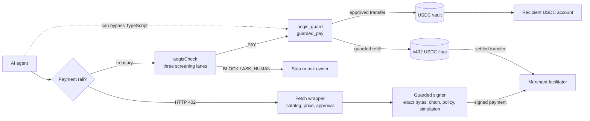
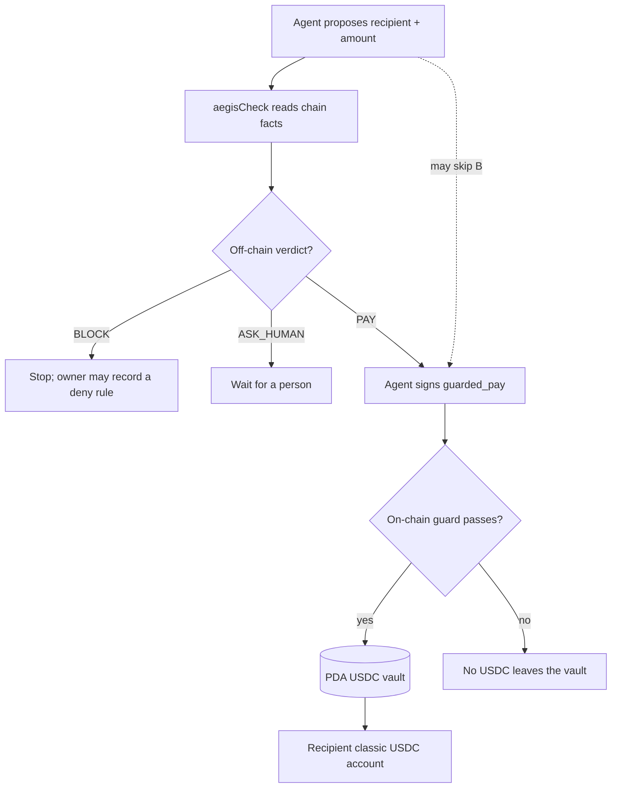
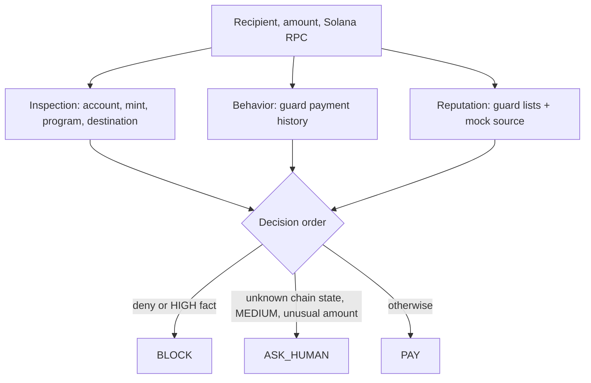
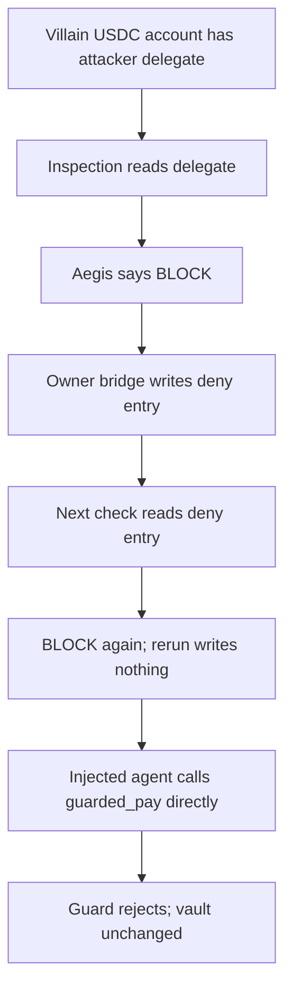
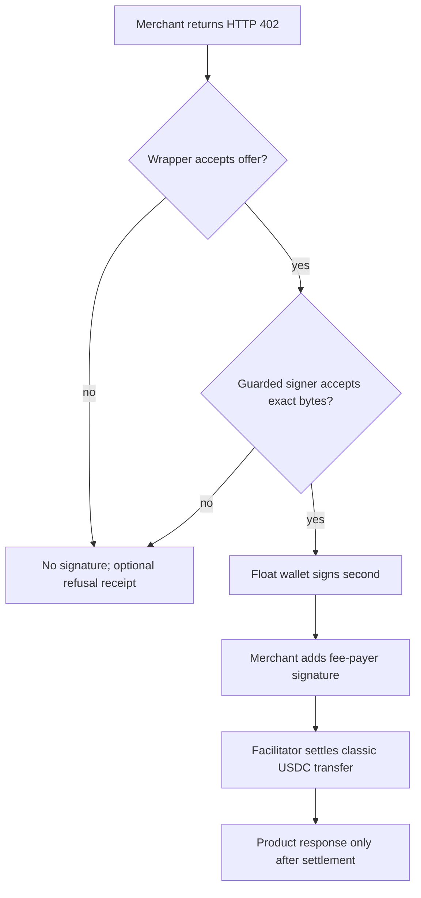
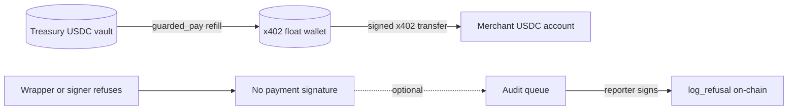
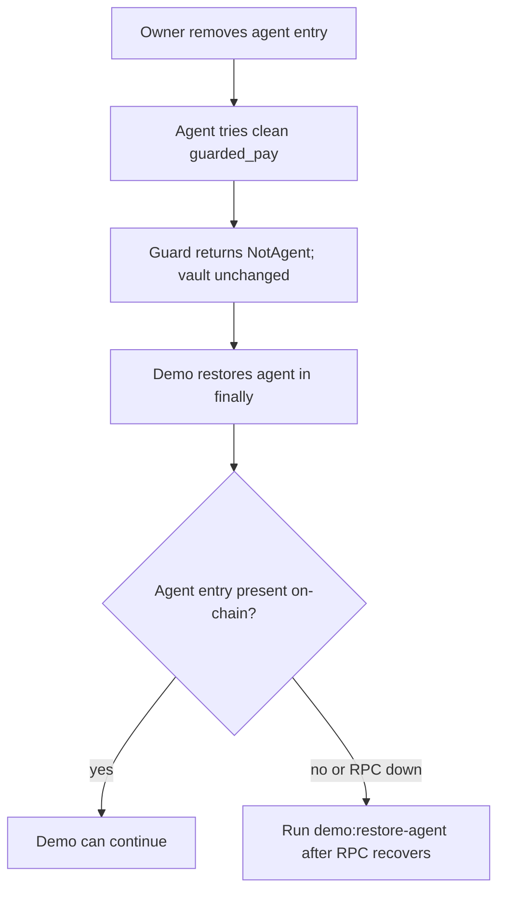

# Aegis on Solana — architecture

An AI agent asks to pay USDC. Aegis answers **PAY**, **BLOCK**, or **ASK_HUMAN** before the payment moves. The project has two payment rails, and each puts a gate at the point the agent cannot bypass. This document is the full map; the [PDF version](architecture.pdf) is made for presenting.

## 1. System overview

The dotted arrow shows the trust boundary: an injected agent can skip the TypeScript treasury check, but cannot move the vault's USDC without `guarded_pay`. On x402, the signature is the gate. The wallet key must stay behind the guarded signer; otherwise that protection is only advice.

| Piece | Job | Where it lives |
|---|---|---|
| `aegisCheck` | Reads facts and returns PAY, BLOCK, or ASK_HUMAN | [decision engine](../src/aegis.ts) and [lanes](../src/lanes/) |
| `aegis_guard` | Enforces the treasury transfer and stores lists, cap, stats, and receipts | [Anchor program](../programs/aegis_guard/src/) |
| x402 wrapper | Decides whether the seller's 402 offer is acceptable | [fetch wrapper](../src/x402/fetch.ts) |
| x402 signer | Checks the exact bytes before the float wallet signs | [signer](../src/x402/signer.ts) |
| Demo merchant | Serves the product and pays the settlement fee as its own facilitator | [merchant](../src/x402/merchant.ts) |

## 2. Treasury rail: normal payment

The guard checks the agent allowlist, deny and blocked-program entries, daily cap, recipient type, and destination token account in the same transaction as the transfer. `assess` can preview its verdict without sending a transaction, but the real transfer still rechecks everything. The on-chain verdict names are PAY, REVIEW, and BLOCK; REVIEW also refuses `guarded_pay` until the owner vets the recipient. A normal preflight rejection may never land. The drain demo uses `skipPreflight` so the failed on-chain transaction is visible in Explorer.

USDC leaves the PDA vault only after the guard approves the transfer. An agent's request cannot override that rule.

## 3. The three screening lanes

Inspection and behavior read real account data. The reputation interface exists, but its external data is mocked; the guard's own list entries are real. The order is deliberate: denylisted recipients and exact HIGH facts block; unreadable chain state, MEDIUM facts, or unusual amounts ask a person; the rest can pay. An optional LLM explains some escalations. The demo skips the model, and a model cannot turn a HIGH fact into PAY.

## 4. Bad recipient: make the block stick

The delegate is visible because it existed **before** payment. The bridge makes the off-chain finding durable with an owner-signed deny entry; it does not auto-allow anything. In the injected-drain beat the agent skips Aegis, but `guarded_pay` still refuses the denylisted recipient. If someone adds a delegate **after** the recipient gets USDC, this pre-payment check cannot stop that later sweep. This limitation matters when interpreting the demo.

## 5. x402 rail: merchant payment

The wrapper checks the catalogued origin and payee, posted price, pinned USDC, and any human approval. The bad-mint demo's Token-2022 look-alike is refused as `NO_PAYABLE_OPTION` before signing. The signer independently decodes the exact v0 transaction bytes, checks the pinned chain and destination, runs `aegisCheck`, and checks simulation and balances. A refusal means no payment signature. The demo merchant acts as its own facilitator and pays SOL fees; the x402 wallet holds zero SOL. The merchant's `product` callback must only prepare response data before settlement, so it must not send an email or consume inventory at that point.

## 6. Float and refusal receipts

The float is a small spending balance, not another vault. `ensureFloat` can top it up only through `guarded_pay`, so each refill uses the treasury guard's daily cap. A refusal receipt is separate from the refused payment. It proves a reporter wrote a receipt; it does **not** prove the payment was stopped, and an empty log proves nothing. The queue keeps writes in order and caps how many reporter fees one run can burn.

## 7. Kill switch and who holds the keys

The owner can stop treasury spending by revoking the agent entry. A process crash or RPC outage can interrupt the demo's restore, so `yarn demo:restore-agent` is the manual recovery command. This does not claw back USDC already in the x402 float; stopping refills and rotating that wallet key is a separate response. Owner and program-upgrade keys remain roots of trust. If the agent can read the raw x402 wallet key, the guarded signer no longer enforces this boundary.

## Reality check before showing this on stage

| Claim | Current status |
|---|---|
| Local validator | Real Anchor instructions, classic SPL transfers, failed transactions, HTTP 402, and refusal receipts. The local USDC mint is a test mint at the devnet USDC address. |
| Devnet | Code and setup target devnet. Deployment, Circle faucet funding, and demo run are the owner's steps; this document does not claim they happened. |
| Facilitator | The demo merchant settles its own payments. Independent facilitator and x402.org devnet interoperability are still untested. |
| AI | Reputation data is mocked. `claude -p` is optional; demo verdicts use deterministic facts with the model skipped. |

Known limits: the merchant's replay memory lives in-process, a delegate added after receipt can still sweep a recipient's USDC, and the x402 key boundary fails if the agent gets the raw wallet key. The guard's daily cap limits treasury outflow, while x402 spending is bounded by the float already in that wallet plus later guarded refills.

For policy edges, code-level limits, and exact refusal codes, [DESIGN.md](../DESIGN.md) is the authority. The [README](../README.md) has the commands.
